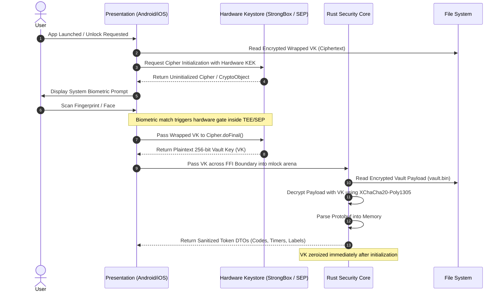

# System Architecture Document
## Project: OpenAuthenticator Core Architecture

---

### 1. High-Level System Topology

OpenAuthenticator adopts a **Headless Security Core** architecture. The cryptographic, serialization, state management, and memory sanitization logic is strictly isolated in an audited, cross-platform **Rust Core**. The mobile presentation layers (Android and iOS) are thin, declarative UI shells communicating with the core via Mozilla `uniffi-rs` (C-ABI).

```
┌─────────────────────────────────────────────────────────────────────────────┐
│                             PRESENTATION LAYER                              │
│                                                                             │
│   Android Client (Kotlin)                    iOS Client (Swift)             │
│   ┌────────────────────────────────┐         ┌───────────────────────────┐  │
│   │ Jetpack Compose UI             │         │ SwiftUI                   │  │
│   │ CameraX + ZXing-cpp (NDK)      │         │ AVFoundation QR Capture   │  │
│   │ BiometricPrompt + CryptoObject │         │ LocalAuthentication + SEP │  │
│   │ WindowManager.FLAG_SECURE      │         │ Privacy Snapshot Masking  │  │
│   └───────────────┬────────────────┘         └─────────────┬─────────────┘  │
└───────────────────┼────────────────────────────────────────┼────────────────┘
                    │                                        │
                    │      UniFFI Foreign Function Interface  │
                    ▼                                        ▼
┌─────────────────────────────────────────────────────────────────────────────┐
│                             RUST SECURITY CORE                              │
│                                                                             │
│   ┌──────────────────────────────────────────────────────────────────────┐  │
│   │ Memory Sanitization Arena (`mlock`, `ZeroizeOnDrop`, `secrecy`)      │  │
│   └──────────────────────────────────┬───────────────────────────────────┘  │
│                                      │                                      │
│   ┌──────────────────────────┐       ▼        ┌──────────────────────────┐  │
│   │ Cryptographic Engine     │ ◄────────────► │ Vault & State Engine     │  │
│   │ - RFC 6238 / 4226 Engine │                │ - Protocol Buffer Parser │  │
│   │ - Argon2id KDF           │                │ - CRDT Reconciliation    │  │
│   │ - XChaCha20-Poly1305     │                │ - Atomic Disk IO         │  │
│   │ - Google Protobuf Migr.  │                │ - Clock-Drift Monotonic  │  │
│   └──────────────────────────┘                └──────────────────────────┘  │
└──────────────────────────────────────┬──────────────────────────────────────┘
                                       │
                                       ▼
┌─────────────────────────────────────────────────────────────────────────────┐
│                      HARDWARE SECURITY MODULES (HSM)                        │
│                                                                             │
│   Android StrongBox / TEE (Keymaster)        Apple Secure Enclave (SEP)     │
│   - Hardware-backed AES-256 KEK              - 256-bit Secure Enclave KEK   │
│   - Bound to User Biometric Fingerprint      - `kSecAccessControlBiometry`  │
└─────────────────────────────────────────────────────────────────────────────┘
```

---

### 2. Cryptographic Key Hierarchy

A critical design flaw in naive authenticators is holding the database master key unencrypted in RAM or decoupling biometric authentication from the cryptographic unwrap. OpenAuthenticator enforces a strict multi-tier key hierarchy:

```
[User Master Password] (Optional, for manual passkey mode)
          │
          ▼ Argon2id (m=64MB, t=3, p=4, Salt=32 bytes CSPRNG)
Derived Password Key (DPK, 256-bit)
          │
          ├────────────────────────────────────────────────┐
          ▼                                                ▼
[Android StrongBox / TEE KeyStore]              [iOS Secure Enclave]
Key Encryption Key (KEK, Hardware-backed)       Key Encryption Key (KEK, SEP-backed)
Constraint: Requires Biometric Auth             Constraint: Requires Biometric Auth
          │                                                │
          └───────────────────────┬────────────────────────┘
                                  ▼ Unwraps (Hardware Decrypt)
                         Vault Key (VK, 256-bit)
                                  │
                                  ▼ Pinned in RAM with `mlock`
           ┌──────────────────────┴──────────────────────┐
           ▼                                             ▼
AEAD Decryption (XChaCha20-Poly1305)           Sync Key Derivation (HKDF-SHA256)
Decrypts Local Encrypted Protobuf Payload      Encrypts Multi-Device CRDT Deltas
```

#### Detailed Key Specifications:
1. **Vault Key (VK)**: 256-bit cryptographically secure pseudorandom number generated on device creation using the operating system's CSPRNG (`getrandom` / `SecRandomCopyBytes`).
2. **Hardware Key Encryption Key (KEK)**:
   * **Android**: An AES-256-GCM key generated inside Android KeyStore (`AndroidKeyStore` provider). Configured with `PURPOSE_ENCRYPT | PURPOSE_DECRYPT`, `setIsStrongBoxBacked(true)` (falling back to TEE), and `.setUserAuthenticationRequired(true)`.
   * **iOS**: A 256-bit key protected via Apple Keychain Services with accessibility flag `kSecAttrAccessibleAfterFirstUnlockThisDeviceOnly` and access control `kSecAccessControlCreateWithFlags(..., kSecAccessControlBiometryCurrentSet)`.
3. **Envelope Encryption**:
   * Plaintext database is encrypted with `XChaCha20-Poly1305` using a fresh 192-bit CSPRNG nonce per write. Nonce collision probability is mathematically negligible ($2^{-96}$).

---

### 3. Biometric Cryptographic Binding Architecture

Many apps perform insecure verification:
```
// INSECURE ANTI-PATTERN:
biometricPrompt.authenticate(..., onAuthenticationSucceeded = {
    unlockVault() // VULNERABLE: Frida/Xposed hooks can bypass this in 1 line
})
```

#### OpenAuthenticator Secure Implementation:
The presentation layer creates a `Cipher` or receives a hardware challenge from the OS Keystore. Decryption of the Vault Key **cannot occur** without the hardware token:



If an attacker hooks `onAuthenticationSucceeded()` with Frida, `Cipher.doFinal()` is never authorized by the hardware enclave, yielding cryptographic garbage.

---

### 4. Memory Architecture & Zeroization Guarantees

Mobile operating systems frequently swap memory pages to disk (zRAM/swap) or leave stale buffers in heap space during garbage collection.

#### 4.1 Memory Locking (`mlock`)
In the Rust core, all data structures holding raw OTP secrets (`SecretKey`, `VaultKey`) are allocated using a custom allocator backed by `libc::mlock`:
* **POSIX Compliance:** Memory pages mapped for secrets are locked into physical RAM, prohibiting the OS kernel from paging them to non-volatile storage or zRAM swap.
* **Core Dump Exclusion:** Memory ranges are flagged with `MADV_DONTDUMP` (Linux) to prevent secrets from appearing in crash dumps.

#### 4.2 Deterministic Scrubbing (`ZeroizeOnDrop`)
To prevent compiler Dead-Store Elimination (DSE), all sensitive structs implement `Zeroize` and `ZeroizeOnDrop`:
```rust
use zeroize::{Zeroize, ZeroizeOnDrop};

#[derive(Zeroize, ZeroizeOnDrop)]
pub struct SensitiveSecret {
    inner: Vec<u8>,
}
```
At the machine code level, memory scrubbing executes explicit memory barriers (`core::sync::atomic::compiler_fence(Ordering::SeqCst)`) and volatile write loops (`core::ptr::write_volatile`), ensuring the optimizer cannot omit memory clearing instructions.

---

### 5. Storage Architecture: Single-File Atomic Envelope vs. SQLite

| Architectural Dimension | SQLite / SQLCipher | OpenAuthenticator Atomic Envelope |
| :--- | :--- | :--- |
| **Typical Token Storage Size** | 100 tokens $\approx$ 150 KB – 500 KB (B-tree overhead) | 100 tokens $\approx$ 8 KB – 25 KB (Protocol Buffer) |
| **Memory Sanitization** | Plaintext pages cached across SQLite pager cache | Single decrypted buffer in pinned RAM, zeroized at drop |
| **Write Durability** | Complex WAL / Journal syncing; prone to corruption if killed during write | **POSIX Atomic Rename** (`fsync` + `renameat2`); 100% crash-safe |
| **Dependency Footprint** | Heavy C codebase (C-amalgamation, OpenSSL/BoringSSL) | Compact, audited Rust parser (`prost` or `cbor`) |

#### Atomic Write Flow:
1. Rust serializes memory vault into a compact Protocol Buffer byte vector.
2. Generates a 24-byte random nonce and encrypts byte vector with XChaCha20-Poly1305.
3. Writes ciphertext to `vault.bin.tmp`.
4. Executes `fsync` on the file descriptor to ensure non-volatile storage commit.
5. Performs atomic rename (`rename("vault.bin.tmp", "vault.bin")`). If the OS terminates the app midway, the previous `vault.bin` remains perfectly intact.

---

### 6. Distributed E2EE Sync Architecture (CRDT)

To enable multi-device sync without compromising privacy or suffering from race conditions, OpenAuthenticator uses a state-based **Last-Write-Wins Element-Set (LWW-Element-Set) Conflict-Free Replicated Data Type**:

```
      Device A (Add Token X)                       Device B (Edit Token Y)
                │                                            │
                ▼                                            ▼
       Local LWW-Element-Set                        Local LWW-Element-Set
   AddSet: { (X, Lamport_A) }                   EditSet: { (Y, Lamport_B) }
                │                                            │
                ▼ Compute Delta                              ▼ Compute Delta
       Encrypted Delta A                            Encrypted Delta B
                │                                            │
                └───────────────► ┌────────────────┐ ◄──────┘
                                  │  Sync Storage  │
                                  │ (Blind Relay / │
                                  │    WebDAV)     │
                                  └────────────────┘
```

#### Sync Rules:
1. **Blind Server Model**: The backend relay only stores ciphertext blobs addressed by `SHA256(SyncPassphraseKey || AccountUUID)`. The server has zero knowledge of token counts, account names, or secrets.
2. **Conflict Resolution**:
   * If Device A and Device B simultaneously edit token $X$, the edit with the higher Lamport timestamp wins.
   * In the event of a tie, the higher cryptographic hash of the ciphertext payload breaks the tie deterministically.
   * Deletions use a **Tombstone** record containing the token UUID and timestamp, preventing "resurrected tokens" when an offline device reconnects.

---

### 7. Threat Modeling & Defense-in-Depth Analysis

| Threat / Attack Vector | Severity | Mitigation Strategy |
| :--- | :--- | :--- |
| **Physical Device Theft (Locked Device)** | High | Hardware-backed KEK in StrongBox/Secure Enclave. Vault cannot be decrypted without biometric sensor interaction or secure lock PIN. |
| **Compromised OS / Root / Jailbreak** | Critical | Biometric authentication is cryptographically bound; Frida hooks cannot forge hardware decryption. Secrets in RAM are locked with `mlock` and zeroized on app lock. |
| **Cold Boot / RAM Dumping** | Medium | Plaintext tokens in RAM are transient; secrets are zeroized on drop. Pinned memory prevents swap-to-disk leaks. |
| **Malicious QR Code Injection** | High | Strict bounds checking on URI parser. Maximum URI length capped at 2048 bytes; fuzzed with `cargo-fuzz` (libFuzzer) against buffer overflows and ReDoS. |
| **Clipboard Snooping Malware** | Medium | Android 13+ `EXTRA_IS_SENSITIVE` flag prevents clipboard overlay snooping. OS clipboard contents automatically overwritten with empty string after 30 seconds. |
| **Screen Recording / Spyware** | Medium | Android `FLAG_SECURE` prevents screenshots and system screen recording. iOS blurs view on backgrounding and overlays sensitive fields with `isSecureTextEntry` canvas. |
| **Cloud Relay Compromise** | Critical | Zero-Knowledge architecture: Server only holds XChaCha20-Poly1305 ciphertext encrypted with user-derived key via Argon2id. Compromise reveals zero metadata. |
